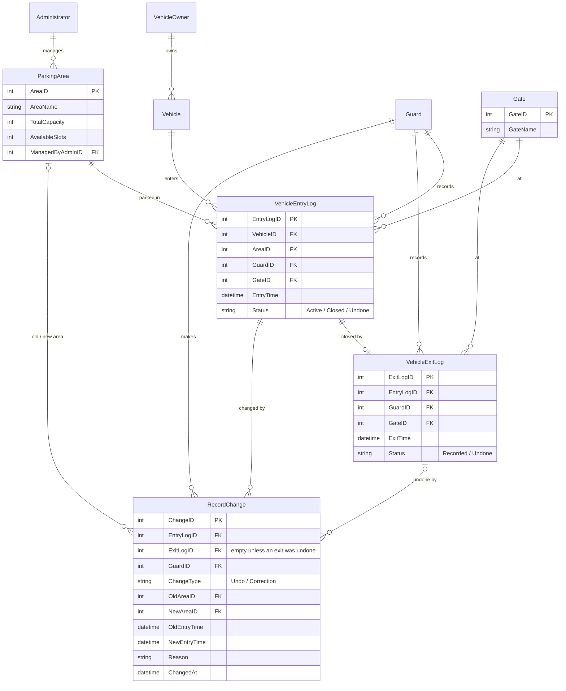
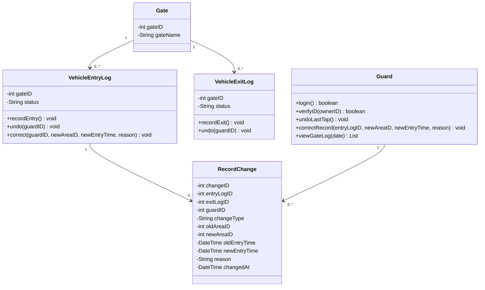

# Reference document updates

The redesigned prototype adds five things the original reference files don't cover:

- undoing the latest tap
- a stored history of corrections
- the gate name
- a gate log for guards
- a warning when availability counts are out of date

It also decides entry or exit from the tap itself. This page lists what to change in each reference file so the documents match the prototype. Each section names the file it affects.

## Summary of decisions

| Topic | Decision |
| --- | --- |
| Direction | The tap decides. Vehicle has an active entry → exit flow. No active entry → entry flow. |
| Double tap | A tap within **2 minutes** of the same vehicle's entry shows "Vehicle already inside" instead of starting an exit. |
| Undo | A guard can undo **only the latest tap at their gate**. The record is kept and marked Undone; slot counts are restored. |
| Correction | A guard can change the **area or entry time** of an earlier record. A reason is required. The original value is kept. |
| Audit | Every undo and correction is stored as a row in a new `RecordChange` table, with the guard and time. |
| Gate | Each entry and exit log stores the gate where it happened. |
| Freshness | Owners see when counts last changed. After **5 minutes** without an update the page warns that counts may be old. No new data is needed. |
| Totals | Undone records are excluded from availability, totals and reports. Corrected records count once, using the corrected values. |

## 1. ERD (`Java_TeamParker_CampusParkingManagementSystem_ERD.png`)

### New entities

**Gate**

| Attribute | Notes |
| --- | --- |
| GateID (PK) | |
| GateName | e.g. "Main gate" |

**RecordChange** (one row per undo or correction)

| Attribute | Notes |
| --- | --- |
| ChangeID (PK) | |
| EntryLogID (FK → VehicleEntryLog) | The parking session that changed |
| ExitLogID (FK → VehicleExitLog) | Only set when an exit was undone; otherwise empty |
| GuardID (FK → Guard) | Who made the change |
| ChangeType | `Undo` or `Correction` |
| OldAreaID (FK → ParkingArea) | Corrections of area only |
| NewAreaID (FK → ParkingArea) | Corrections of area only |
| OldEntryTime | Corrections of time only |
| NewEntryTime | Corrections of time only |
| Reason | Required for `Correction`, optional for `Undo` |
| ChangedAt | Date and time of the change |

### Changed entities

| Entity | Change |
| --- | --- |
| VehicleEntryLog | Add **GateID (FK → Gate)**. Status becomes **Active / Closed / Undone**. |
| VehicleExitLog | Add **GateID (FK → Gate)**. Add **Status: Recorded / Undone**. |

### New relationships

- Gate 1 — 0..* VehicleEntryLog
- Gate 1 — 0..* VehicleExitLog
- VehicleEntryLog 1 — 0..* RecordChange
- VehicleExitLog 1 — 0..* RecordChange
- Guard 1 — 0..* RecordChange
- ParkingArea 1 — 0..* RecordChange (twice: old area and new area)

### Updated ERD

Only the changed parts are shown in full; `VehicleOwner`, `Vehicle`, `Administrator` and `Guard` keep their current attributes.



## 2. Class diagram (spreadsheet tab "Class Diagram")

### New classes

```
Gate
- gateID : int
- gateName : String

RecordChange
- changeID : int
- entryLogID : int {FK}
- exitLogID : int {FK, optional}
- guardID : int {FK}
- changeType : String        // "Undo" or "Correction"
- oldAreaID : int {FK, optional}
- newAreaID : int {FK, optional}
- oldEntryTime : DateTime {optional}
- newEntryTime : DateTime {optional}
- reason : String
- changedAt : DateTime
```

### Changed classes

| Class | Add |
| --- | --- |
| VehicleEntryLog | `- gateID : int {FK}`; status values Active / Closed / Undone; `+ undo(guardID) : void`; `+ correct(guardID, newAreaID, newEntryTime, reason) : void` |
| VehicleExitLog | `- gateID : int {FK}`; `- status : String` (Recorded / Undone); `+ undo(guardID) : void` |
| Guard | `+ undoLastTap() : void`; `+ correctRecord(entryLogID, newAreaID, newEntryTime, reason) : void`; `+ viewGateLog(date) : List` |
| Administrator | No new methods. `viewParkingHistory()` now also returns each record's `RecordChange` rows. |
| ParkingArea | No change. Undo and correction reuse `increaseSlot()` and `decreaseSlot()`. |

### New associations

- Gate 1 — 0..* VehicleEntryLog, Gate 1 — 0..* VehicleExitLog
- VehicleEntryLog 1 — 0..* RecordChange, Guard 1 — 0..* RecordChange



## 3. Use case diagram (`use case diagram - ruiz.pdf`)

Under **Guard Features**:

- Rename **Assign Parking Area** to **Record Chosen Area**. The spreadsheet version already uses that name; the PDF doesn't.
- Add **Undo Last Tap**, with «extend» arrows to Check In Vehicle and Check Out Vehicle.
- Add **View Today's Gate Log**.
- Keep **Correct Parking Record**; it's now a full use case (written below).

Under **Student / Vehicle Owner Features**, no new use cases. View Parking Availability now also shows when counts were last updated.

## 4. Written use cases (spreadsheet tab "Use Case Diagram")

### UC-01 Check In Vehicle: changes only

- **Successful scenario, step 3:** "The system retrieves the vehicle's registered information, finds no active entry, and retrieves current parking availability."
- **Successful scenario, step 5:** "The guard presses the owner's chosen area; the system records the entry at the guard's gate and decreases that area's slot count by 1."
- **Add exception:** "The same vehicle tapped within 2 minutes of its entry. The system shows 'Vehicle already inside' and doesn't start an exit."
- **Add remark:** "The guard can undo this entry while it is the latest tap at the gate (UC-Undo)."

### UC-02 Check Out Vehicle: changes only

- **Precondition:** "The vehicle has an active entry." The tap opens the exit flow automatically when one exists.
- **Add remark:** "The guard can undo this exit while it is the latest tap at the gate (UC-Undo)."

### UC-0X Undo Last Tap (new)

| Field | Content |
| --- | --- |
| Use Case Name | Undo Last Tap |
| Purpose | To reverse an entry or exit that was recorded by mistake, immediately after it happened. |
| Primary Actor | Guard |
| Secondary Actor | None |
| Input Parameter/s | The latest tap at the guard's gate |
| Output Parameter/s | Record marked Undone; restored slot count |
| Pre-condition/s | The guard is signed in. The tap is the latest one recorded at this gate. |
| Post-condition | The entry (or exit) is marked Undone and kept. The area's slot count is restored. A RecordChange row of type Undo is saved. |
| Successful Scenario | 1.) The guard presses Undo on the confirmation screen or in the Last taps strip. 2.) The system marks the record Undone. 3.) The system restores the slot count: +1 for an undone entry, −1 for an undone exit (and the entry becomes Active again). 4.) The system saves who undid it and when. 5.) The reader screen confirms the undo. |
| Exceptions | A newer tap has been recorded at this gate since; the guard must use Correct Parking Record instead. |
| Additional Remarks | Undone records stay visible to administrators in parking history and are excluded from totals and reports. |

### UC-0X Correct Parking Record (written out)

| Field | Content |
| --- | --- |
| Use Case Name | Correct Parking Record |
| Purpose | To fix the area or entry time of an earlier record that is no longer the latest tap. |
| Primary Actor | Guard |
| Secondary Actor | Administrator (reviews corrections) |
| Input Parameter/s | Parking record; new area and/or entry time; reason |
| Output Parameter/s | Corrected record; updated slot counts |
| Pre-condition/s | The guard is signed in. The record exists and is not Undone. |
| Post-condition | The record shows the corrected values. The original values are kept in a RecordChange row of type Correction, with the guard, time and reason. If the area changed, the old area gains one free slot and the new area loses one. |
| Successful Scenario | 1.) The guard opens Help → Correct a record. 2.) The guard finds the record. 3.) The guard changes the area and/or entry time. 4.) The guard enters a reason. 5.) The system shows the slot impact and saves the correction. |
| Exceptions | No reason entered: the system doesn't save. The new area is full: the system doesn't allow it. |
| Additional Remarks | Administrators see "Corrections today" on the overview and each correction in the session timeline. |

### UC-0X View Today's Gate Log (new)

| Field | Content |
| --- | --- |
| Use Case Name | View Today's Gate Log |
| Purpose | To let a guard check every tap at their gate today, for example before correcting a record. |
| Primary Actor | Guard |
| Input Parameter/s | Gate, today's date |
| Output Parameter/s | List of entries, exits and failed taps, newest first |
| Pre-condition/s | The guard is signed in. |
| Post-condition | None (read-only). |
| Successful Scenario | 1.) The guard opens Help → Today's log. 2.) The system lists today's taps at this gate. |
| Exceptions | None. |
| Additional Remarks | Limited to the guard's own gate and today. Full history remains an administrator feature. |

## 5. Functional requirements (spreadsheet tab "Functional Requirements")

**Objective 1, Module 1** — add:

- Transaction 3: The system shows when the slot counts were last updated, and warns the owner when they are more than 5 minutes old.

**Objective 2, Module 1 (Vehicle Entry)** — change Transaction 1 and add Transaction 3:

- Transaction 1: The guard can read and verify a vehicle owner's ID card upon arrival. If the vehicle already has an active entry, the system opens the exit flow instead.
- Transaction 3: The guard can undo the latest entry at their gate, which restores the area's slot count.

**Objective 2, Module 2 (Vehicle Exit)** — add:

- Transaction 3: The guard can undo the latest exit at their gate, which makes the entry active again and restores the area's slot count.

**Objective 2, new Module 3: Record Correction**

- Transaction 1: The guard can correct the area or entry time of an earlier record, with a required reason. The original values are kept.
- Transaction 2: The guard can view today's log of taps at their gate.

**Objective 3, Module 2 (Reporting & History)** — change Transaction 1:

- Transaction 1: The administrator can view the parking history of all recorded entries and exits, including undone and corrected records with who changed them and when.

## 6. Activity diagrams

**Vehicle Entry** (`Activity Diagram — Vehicle Entry - jaca.pdf`)

1. After *Retrieve vehicle information*, add a decision **"Vehicle has an active entry?"**
   - Yes, entry less than 2 minutes old → *Display "Vehicle already inside"* → End.
   - Yes, older → go to the Vehicle Exit diagram at *Confirm vehicle exit*.
   - No → continue to *Retrieve current parking availability* (unchanged).
2. Rename *Assign parking area* (Guard lane) to **Record owner's chosen area**.
3. In the Database lane, *Save vehicle entry* now saves the gate as well.

**Vehicle Exit** (`Activity Diagram — Vehicle Exit - jaca.pdf`)

- No new steps. *Save vehicle exit* now saves the gate as well. The entry point is the decision added to the entry diagram, so both start from one tap.

**New: Undo Last Tap** (small diagram, Guard / System / Database lanes)

Guard presses Undo → System checks it's the latest tap at this gate → (No → *Show "Use Correct a record"* → End) → Yes → Database marks the record Undone → System restores the slot count → Database saves a RecordChange (Undo) → System confirms on the reader screen → End.

**New: Correct Parking Record**

Guard opens Correct a record → finds the record → enters new area/time and a reason → System checks a reason is present and the new area has space → (No → show what's missing) → Yes → Database saves a RecordChange (Correction) with old and new values → System adjusts both areas' slot counts → Database updates the record → System confirms → End.

## 7. Sequence diagram (`sequence_diagram_updated.pdf`)

- **Process 1, after step 5** (*Return vehicle information*): add an **alt** fragment. [no active entry] → steps 6–15 as now. [active entry] → continue with Process 2 from step 21.
- **Process 1, step 11:** rename to *Press owner's chosen area* (recording is immediate).
- **Process 1, step 12** and **Process 2, step 23:** add the gate: *Record vehicle entry (gate)* / *Record vehicle exit (gate)*.
- **New Process 4 — Undo Last Tap:** Guard → Parking System: *Undo latest tap*; Parking System → Database: *Mark record Undone*; Parking System → Database: *Restore slot count*; Parking System → Database: *Save change (Undo)*; Database → Parking System: *Confirm*; Parking System → Guard Dashboard: *Update parking availability*.
- **New Process 5 — Correct Parking Record:** Guard → Parking System: *Submit correction (area/time, reason)*; Parking System → Database: *Save change (Correction, old and new values)*; Parking System → Database: *Update record and both areas' slot counts*; Database → Parking System: *Confirm*; Parking System → Guard Dashboard: *Update parking availability*.
